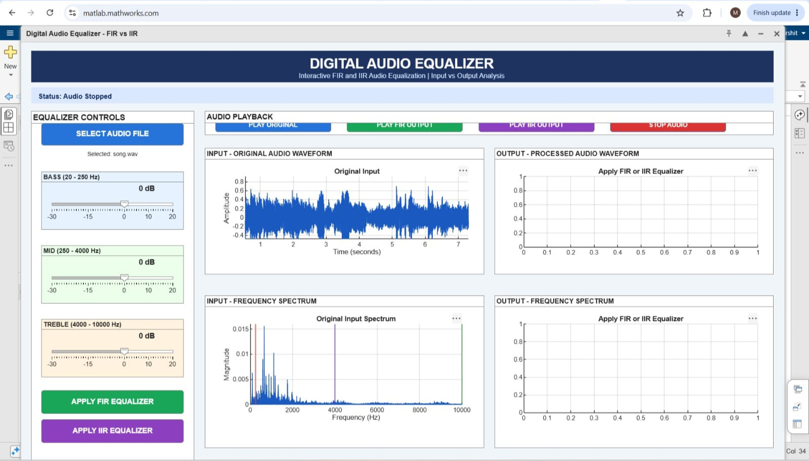
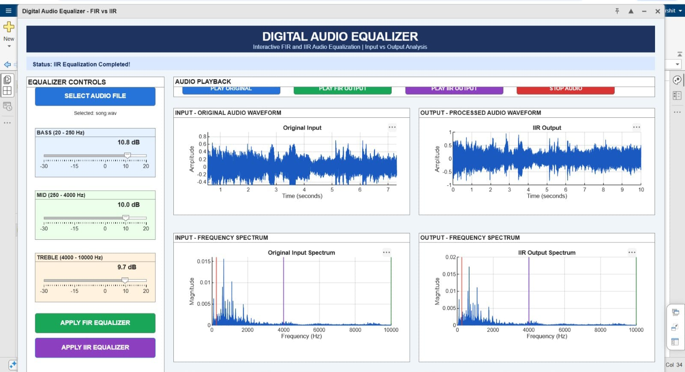

# Digital Audio Equalizer - FIR vs IIR

Interactive FIR and IIR Audio Equalization with Input vs Output Analysis



## Overview

This project implements a digital audio equalizer using both FIR (Finite Impulse Response) and IIR (Infinite Impulse Response) filters. The application provides an interactive GUI for real-time audio equalization with visual feedback through waveform and frequency spectrum analysis.

## Features

- **Interactive GUI**: User-friendly MATLAB App Designer interface
- **Dual Filter Types**: Compare FIR and IIR filter performance
- **Three-Band Equalizer**:
  - **Bass** (20 - 250 Hz): Low-frequency control
  - **Mid** (250 - 4000 Hz): Mid-range frequency control
  - **Treble** (4000 - 10000 Hz): High-frequency control
- **Real-time Visualization**:
  - Input/Output waveform comparison
  - Frequency spectrum analysis with band markers
- **Audio Playback**: Listen to original, FIR-processed, and IIR-processed audio
- **Adjustable Gain**: -30 dB to +20 dB range for each band

## Screenshots

### Input - Original Audio


The input panel displays the original audio waveform and frequency spectrum before any equalization is applied.

### Output - Processed Audio


The output panel shows the processed audio waveform and frequency spectrum after applying FIR or IIR equalization.

## Project Structure

```
Digital_audio_equalizer/
├── AudioEqualizerGui.m      # Main GUI application
├── main.m                   # Script-based equalizer
├── functions/
│   ├── design_fir_filter.m  # FIR filter design
│   └── design_iir_filter.m  # IIR filter design
├── input/                   # Directory for input audio files
├── output/                  # Directory for processed audio files
└── results/                 # Directory for analysis graphs
```

## Requirements

- MATLAB R2019b or later
- Signal Processing Toolbox
- Audio Toolbox (recommended)

## Installation

1. Clone the repository:
```bash
git clone https://github.com/harsherchauhan18/Digital_Audio_Equalizer.git
```

2. Open MATLAB and navigate to the project directory

3. Add the functions folder to the MATLAB path (if running main.m)

## Usage

### GUI Application

1. Run the GUI:
```matlab
AudioEqualizerGUI
```

2. **Select Audio File**: Click "SELECT AUDIO FILE" and choose a WAV file

3. **Adjust Equalizer Bands**:
   - Use the Bass slider to adjust low frequencies (-30 to +20 dB)
   - Use the Mid slider to adjust mid frequencies (-30 to +20 dB)
   - Use the Treble slider to adjust high frequencies (-30 to +20 dB)

4. **Apply Equalization**:
   - Click "APPLY FIR EQUALIZER" for FIR-based processing
   - Click "APPLY IIR EQUALIZER" for IIR-based processing

5. **Playback**:
   - "PLAY ORIGINAL": Listen to the unprocessed audio
   - "PLAY FIR OUTPUT": Listen to FIR-processed audio
   - "PLAY IIR OUTPUT": Listen to IIR-processed audio
   - "STOP AUDIO": Stop current playback

6. **Visual Analysis**: Observe the waveform and frequency spectrum changes in real-time

### Script-Based Processing

1. Place your audio file in the `input/` folder (must be a .wav file)

2. Run the main script:
```matlab
main
```

3. The script will:
   - Load and analyze the audio
   - Apply FIR and IIR equalization
   - Generate comparison graphs
   - Save processed audio files to `output/`
   - Save analysis results to `results/`

## Technical Details

### FIR Filters
- Filter Order: 100
- Design Method: Window-based FIR design
- Bands:
  - Low-pass for Bass (0-250 Hz)
  - Band-pass for Mid (250-4000 Hz)
  - High-pass for Treble (>4000 Hz)

### IIR Filters
- Filter Type: Butterworth
- Filter Order: 6
- Bands:
  - Low-pass for Bass (0-250 Hz)
  - Band-pass for Mid (250-4000 Hz)
  - High-pass for Treble (>4000 Hz)

### Frequency Bands

| Band | Frequency Range | Description |
|------|----------------|-------------|
| Bass | 20 - 250 Hz | Low frequencies, bass instruments |
| Mid | 250 - 4000 Hz | Vocals, most instruments |
| Treble | 4000 - 10000 Hz | High frequencies, cymbals, detail |

## Output Files

The script generates the following outputs:

- `output/FIR_Equalized_Audio.wav` - FIR-processed audio
- `output/IIR_Equalized_Audio.wav` - IIR-processed audio
- `results/Original_Audio_Analysis.png` - Original audio analysis
- `results/FIR_Band_Separation.png` - FIR frequency band visualization
- `results/Original_vs_FIR_Equalized.png` - Waveform comparison
- `results/Frequency_Spectrum_Comparison.png` - Spectrum comparison
- `results/RMS_Comparison.png` - RMS amplitude comparison

## FIR vs IIR Comparison

### FIR Filters
- **Advantages**: Linear phase response, stable, predictable behavior
- **Disadvantages**: Higher computational cost, requires higher filter order
- **Best for**: Applications requiring phase linearity

### IIR Filters
- **Advantages**: Lower computational cost, efficient for sharp cutoffs
- **Disadvantages**: Non-linear phase, potential stability issues
- **Best for**: Real-time applications, resource-constrained systems

## Performance Metrics

The script calculates and compares:
- Signal Power
- RMS (Root Mean Square) Amplitude
- Frequency Response
- Processing Time

## Troubleshooting

- **No audio file found**: Ensure your WAV file is in the `input/` folder
- **Filter design errors**: Check that your audio sample rate is sufficient for the frequency bands
- **Playback issues**: Ensure audio output is configured in MATLAB
- **GUI not responding**: Stop any currently playing audio before applying new settings

## License

This project is open source and available for educational purposes.

## Author

Harshvardhan Singh Chauhan

## Acknowledgments

- MATLAB Signal Processing Toolbox
- MATLAB Audio Toolbox
